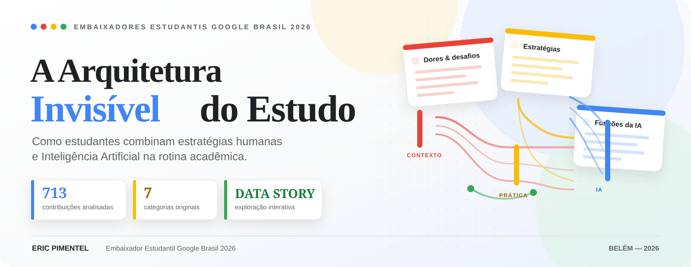
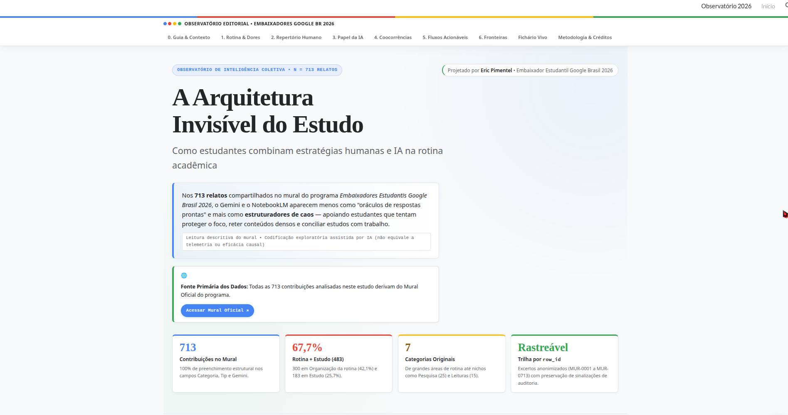
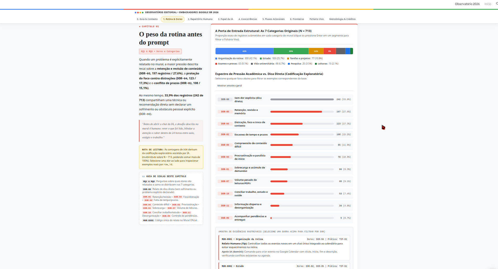
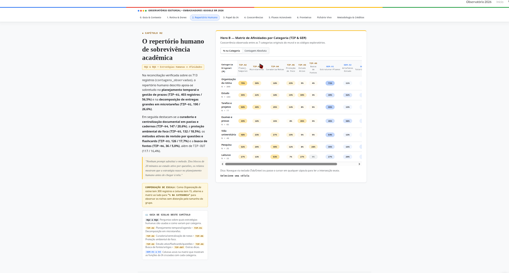
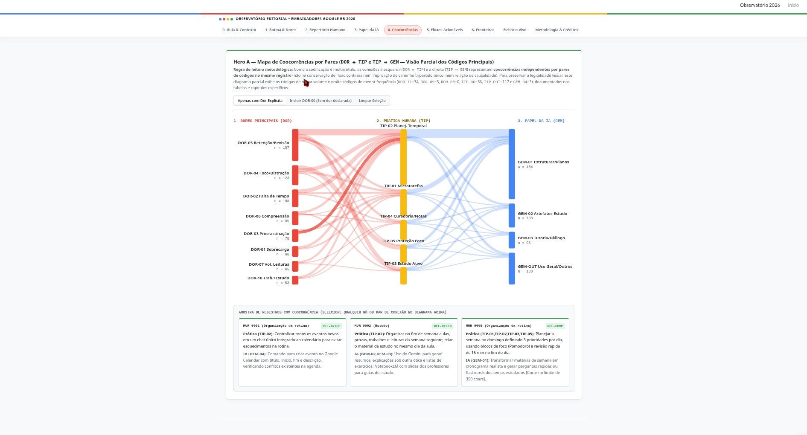
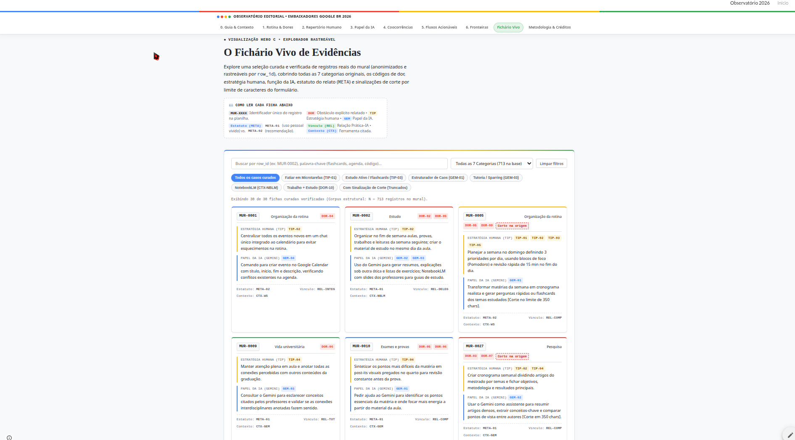
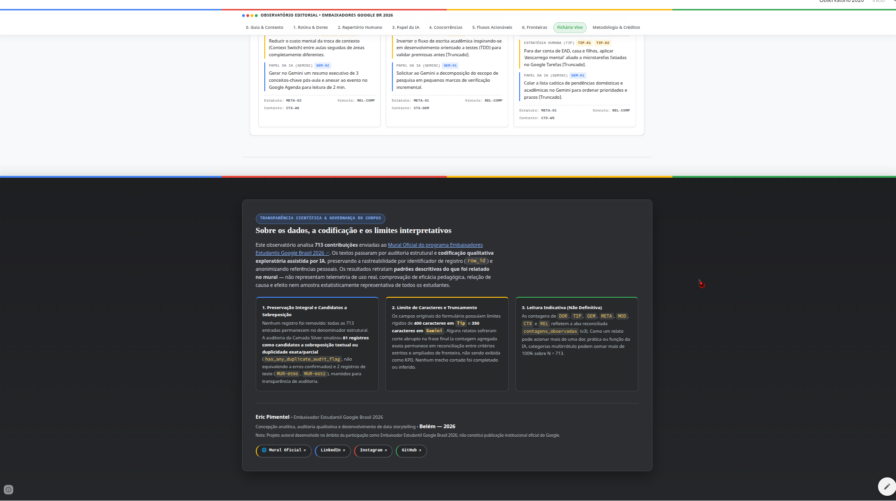

<div align="center">



# 🧠 A Arquitetura Invisível do Estudo

### Como estudantes combinam estratégias humanas e Inteligência Artificial na rotina acadêmica

**Um experimento de análise qualitativa, visualização de dados e storytelling interativo**

[](https://enps2015.github.io/observatorio-embaixadores-google-2026/)
[](https://mural-embaixadores-br.web.app)
[](https://github.com/enps2015)

**Eric Pimentel** · Embaixador Estudantil Google Brasil 2026 · Belém, Pará — 2026

</div>

---

## ✨ Sobre o projeto

O que acontece quando juntamos **dados, Inteligência Artificial e curiosidade sobre como aprendemos**?

*A Arquitetura Invisível do Estudo* é um observatório editorial interativo que explora **713 contribuições de um mural acadêmico**, organizadas em sete categorias. O projeto investiga como os relatos descrevem práticas de organização, estudo, revisão, gestão de prazos e uso de ferramentas como Gemini e NotebookLM.

A ideia não foi criar apenas mais um dashboard. Foi transformar uma análise em uma experiência de **data storytelling**: uma narrativa visual que conduz a pessoa pelos temas, evidencia conexões e permite explorar exemplos do material analisado.

> **A pergunta central:** como a Inteligência Artificial pode apoiar a aprendizagem e a organização acadêmica sem retirar o protagonismo de quem aprende?

🔗 **[Acesse o Mural oficial dos Embaixadores](https://mural-embaixadores-br.web.app)**

> **Nota:** esta é uma iniciativa autoral desenvolvida no contexto da participação no programa Embaixadores Estudantis Google Brasil 2026. Não é uma publicação institucional oficial do Google.

## 🎯 Objetivos

- Explorar o que os relatos dizem sobre a rotina e os desafios acadêmicos.
- Descrever estratégias humanas de organização e aprendizagem presentes no mural.
- Investigar as funções atribuídas ao Gemini e ao NotebookLM nos textos.
- Criar visualizações que permitam comparar categorias e explorar coocorrências.
- Aproximar análise qualitativa, visualização da informação e desenvolvimento web.
- Comunicar resultados de forma compreensível, sem esconder limitações metodológicas.

## 🧭 Como navegar pelo observatório

A experiência está organizada em seis capítulos editoriais e um explorador de evidências.

| Seção | O que você encontrará |
|---|---|
| **01 — O peso da rotina antes do prompt** | Categorias do mural e códigos exploratórios relacionados a dificuldades e obstáculos descritos. |
| **02 — O repertório humano de sobrevivência acadêmica** | Estratégias de planejamento, organização, foco e revisão. |
| **03 — A IA como organizadora e descompressora cognitiva** | Funções atribuídas ao Gemini e ao NotebookLM nos relatos. |
| **04 — A coreografia entre mente e máquina** | Visualização de coocorrências entre códigos de dor, prática humana e papel da IA. As conexões representam associações textuais, não causalidade. |
| **05 — Anatomia de fluxos acionáveis** | Exemplos que mostram como uma estratégia, um comando e um resultado esperado podem formar um fluxo de trabalho. |
| **06 — Pontos cegos e fronteiras abertas** | Temas menos frequentes no corpus e perguntas que podem orientar novas explorações. |
| **Fichário Vivo de Evidências** | Consulta de exemplos selecionados, com identificadores de registro e filtros temáticos. |

### 🔎 Três recursos interativos

**Tear da Rotina**  
Ajuda a explorar coocorrências entre os códigos usados para descrever desafios, estratégias humanas e funções da IA.

**Matriz de Afinidades**  
Permite comparar códigos exploratórios entre as sete categorias do mural, alternando entre contagens absolutas e percentuais dentro da categoria.

**Fichário Vivo**  
Reúne uma seleção de exemplos rastreáveis por `row_id`, com pesquisa textual e filtros para facilitar a consulta.

## 🖼️ Capturas de tela

Veja abaixo alguns recortes da experiência web. As imagens estão organizadas por área da aplicação; abra cada item para ampliar a captura em sua resolução original.

<details>
<summary><strong>01 — Abertura e visão geral do observatório</strong></summary>
<p align="center">
  <a href="assets/captura-01-abertura.png"></a>
</p>
</details>

<details>
<summary><strong>02 — O peso da rotina e os desafios relatados</strong></summary>
<p align="center">
  <a href="assets/captura-02-rotina-dores.png"></a>
</p>
</details>

<details>
<summary><strong>03 — Matriz de afinidades</strong></summary>
<p align="center">
  <a href="assets/captura-03-matriz-afinidades.png"></a>
</p>
</details>

<details>
<summary><strong>04 — Tear da Rotina: coocorrências entre temas</strong></summary>
<p align="center">
  <a href="assets/captura-04-tear-rotina.png"></a>
</p>
</details>

<details>
<summary><strong>05 — Fichário Vivo de Evidências</strong></summary>
<p align="center">
  <a href="assets/captura-05-fichario-vivo.png"></a>
</p>
</details>

<details>
<summary><strong>06 — Metodologia, limitações e créditos</strong></summary>
<p align="center">
  <a href="assets/captura-06-metodologia-creditos.png"></a>
</p>
</details>

## 📊 A base em números

- **713 contribuições** no mural analisado.
- **7 categorias originais**.
- **483 registros (aproximadamente 67,7%)** nas duas categorias mais numerosas: Organização da rotina (300) e Estudo (183).

As contagens acima descrevem a estrutura do corpus. Já as frequências dos códigos temáticos exibidos no observatório vêm de **codificação exploratória assistida por IA** e devem ser interpretadas como indicativas, não como prevalências definitivas.

## 🧪 Metodologia e interpretação responsável

O projeto combina inspeção estrutural da base, auditoria técnica, leitura exploratória, criação de um codebook e codificação qualitativa assistida por IA. Os códigos ajudam a organizar padrões textuais, mas não substituem uma validação semântica completa de todos os registros.

Por isso, é importante distinguir:

- **Dado estrutural:** número de registros e distribuição nas categorias originais.
- **Indicador exploratório:** frequência de códigos atribuídos a textos, útil para orientar a leitura e levantar hipóteses.
- **Conclusão causal ou sobre eficácia:** não pode ser estabelecida apenas pelos relatos deste mural.

### Limites importantes

1. **713 contribuições não significam 713 pessoas distintas.** O total refere-se a registros, não a participantes únicos.
2. O mural é um conjunto específico de relatos, não uma amostra representativa de todos os estudantes.
3. A codificação temática foi assistida por IA e é exploratória. Seus números não devem ser tratados como classificação definitiva ou medida validada de comportamento.
4. Coocorrência entre códigos não demonstra que um elemento causou outro nem que uma ferramenta melhorou a aprendizagem.
5. Registros sinalizados por possível duplicidade são candidatos para revisão; isso não significa que sejam erros confirmados.
6. Há sinalizações de possível truncamento em textos de origem. Como as contagens dessas sinalizações não ficaram plenamente reconciliadas entre os artefatos de auditoria, elas não são apresentadas como um indicador consolidado.
7. Os exemplos exibidos no fichário são uma seleção curada; não devem ser confundidos com uma amostra aleatória ou representativa do corpus.

O compromisso do projeto é **explorar sem exagerar o que os dados permitem afirmar**.

## 🛠️ Tecnologias e abordagem

A aplicação foi concebida como uma página web estática e autônoma, com recursos de apresentação e interação no navegador.

- **HTML5** para a estrutura semântica.
- **CSS3** para identidade visual, hierarquia editorial e responsividade.
- **JavaScript** para filtros, navegação e visualizações interativas.
- **SVG** para representação vetorial de conexões.
- **Análise qualitativa assistida por IA** para apoiar a exploração e organização dos relatos.
- **Data storytelling** para articular evidências, visualizações e narrativa.

A interface foi projetada para funcionar sem backend próprio nem bibliotecas carregadas por CDN. O funcionamento final deve ser confirmado no arquivo HTML disponibilizado neste repositório.

## 🚀 Executar localmente

O projeto foi pensado para ser simples de experimentar.

1. Clone ou baixe este repositório.
2. Abra o arquivo HTML principal no navegador.
3. Explore os capítulos, alterne a visualização da matriz e teste os filtros do Fichário Vivo.

Exemplo com Git:

```bash
git clone https://github.com/enps2015/observatorio-embaixadores-google-2026.git
cd observatorio-embaixadores-google-2026
```

> O arquivo principal da aplicação está disponível como `index.html` na raiz do repositório. Basta abrir esse arquivo em um navegador para explorar a versão estática localmente.

## 🌐 Acesse o observatório publicado

🚀 **[Abrir A Arquitetura Invisível do Estudo no GitHub Pages](https://enps2015.github.io/observatorio-embaixadores-google-2026/)**

A aplicação está hospedada como um site estático pelo GitHub Pages. O código-fonte da aplicação está no arquivo `index.html` deste repositório.

### Como publicar atualizações

Quando alterar a aplicação, envie as mudanças para a branch `main`. Com o GitHub Pages configurado para publicar a partir de `main` e da pasta `/(root)`, o site será atualizado após o término da implantação.

Para conferir as configurações, acesse **Settings → Pages** no repositório.

## 📁 Estrutura sugerida do repositório

O repositório está organizado para separar a aplicação, as capturas de tela e a documentação do experimento:

```text
observatorio-embaixadores-google-2026/
├── index.html          # Aplicação web estática
├── README.md           # Apresentação, método e instruções
├── assets/
│   ├── capa-readme.svg
│   ├── captura-01-abertura.png
│   ├── captura-02-rotina-dores.png
│   ├── captura-03-matriz-afinidades.png
│   ├── captura-04-tear-rotina.png
│   ├── captura-05-fichario-vivo.png
│   └── captura-06-metodologia-creditos.png
└── docs/
    └── relatorio-final.md
```

Mantenha apenas os materiais necessários para reproduzir, entender e divulgar o projeto. Planilhas de trabalho, registros brutos ou arquivos com informações pessoais não devem ser publicados sem uma avaliação prévia de privacidade e autorização.

## 👤 Autoria e contato

**Eric Pimentel**  
Embaixador Estudantil Google Brasil 2026  
Belém, Pará, Brasil — 2026

- [LinkedIn](https://www.linkedin.com/in/ericpimentel-dados/)
- [Instagram](https://www.instagram.com/eric.n.pimentel/)
- [GitHub](https://github.com/enps2015)

## 🙌 Por que compartilhar este experimento?

Porque aprender a trabalhar com IA não é apenas aprender a escrever prompts. É também formular perguntas melhores, examinar evidências, reconhecer incertezas e transformar uma ideia em algo que outras pessoas possam explorar.

Este observatório é um exercício prático nessa direção: **dados para investigar, IA para apoiar a análise e storytelling para compartilhar o que descobrimos.**

Se o projeto despertar uma pergunta nova sobre aprendizagem, organização ou uso crítico da IA, já terá cumprido uma parte importante de seu propósito.

---

<div align="center">

**A Arquitetura Invisível do Estudo**  
*Um experimento autoral de dados, IA e aprendizagem.*

Feito por **Eric Pimentel** · Belém — 2026

</div>
